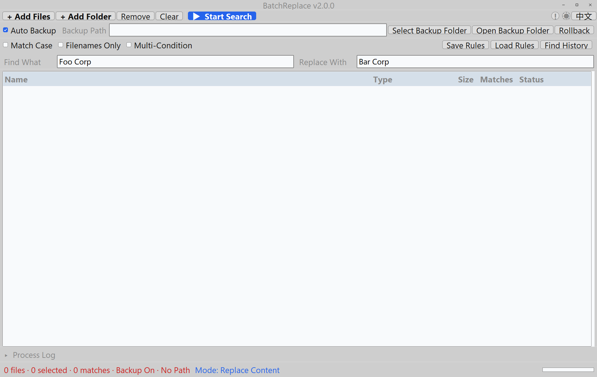
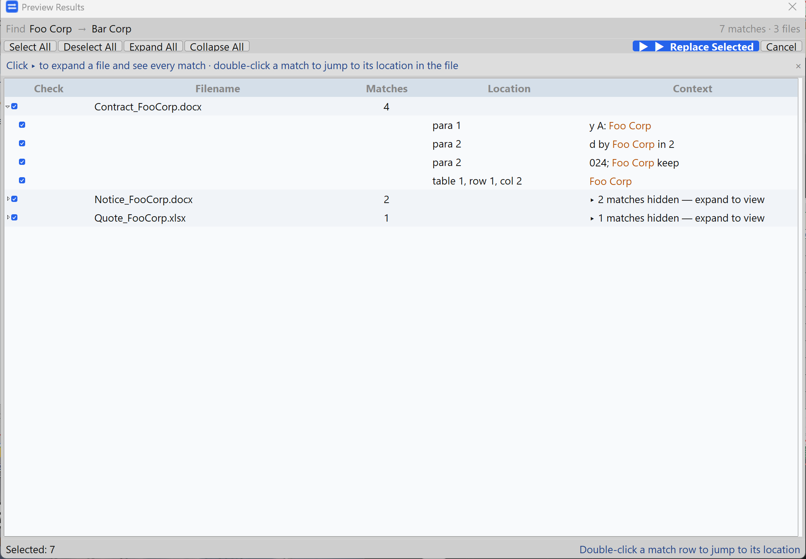
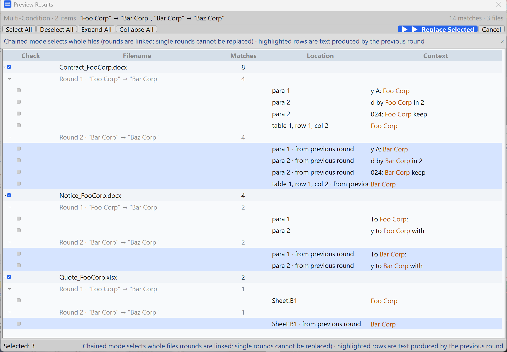
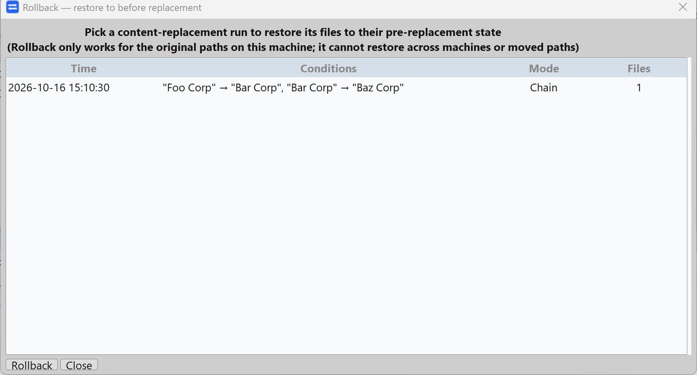

# BatchReplace

[](https://github.com/YehOlt/BatchReplace/releases)
[](https://github.com/YehOlt/BatchReplace/blob/main/LICENSE)


[简体中文](README.md) ｜ **English**

**A batch find-and-replace tool**: replace text across many Word / Excel / plain-text documents at once, keeping all original formatting and encoding intact.

Process **multiple files** in one run and stack **several replacement rules** at a time (for example `Foo Corp→Bar Corp` together with `2024→2025`). Preview every match before touching anything, tick individual rows, and let the tool back up the originals first. Supports `.docx` / `.xlsx` / `.txt`.

A Windows desktop tool (tkinter GUI). The whole program is a single file, `BatchReplace.py` — copy it anywhere and run it, or freeze it into a standalone exe that needs no Python installation. Free and open source (MIT).

**Current version: v2.0.0**

---

## Screenshots

**Main window** (initial state):



**After clicking "Start Search"**: every match is listed file by file, tickable row by row, double-click to jump:



**Chained-replacement preview**: grouped by round, with rows that land on text produced by an earlier round highlighted:



**Rollback dialog**: lists every content-replacement record; pick one to restore its files:



## Features

### Batch replacement

- **Batch replacement**: process many files at once — `.docx` (body paragraphs, tables, headers and footers), `.xlsx` (cells across all worksheets) and `.txt` (whole file, original encoding kept)
- **Formatting preserved**: only the matched text is rewritten; the document is never rebuilt, so fonts, styles and merged cells stay exactly as they were; `.txt` files keep their original encoding (UTF-8 / GBK / BOM all round-trip unchanged)
- **Multi-condition replacement** (optional): apply several "find → replace with" rules in a single search / replace pass — for example `Foo Corp→Bar Corp` together with `2024→2025`. All rules match against the **original** text and every change is located in one pass; there is **no chaining** (`a→b` and `b→c` applied to `ab` yield `bc`, not `cc`)
- **Parallel / chained execution** (a dropdown next to multi-condition, parallel by default): **parallel** = every condition matches the original text, all replaced in one pass; **chained** = rules run top to bottom and **each one searches what the previous one produced** (ideal for staged renames like `Foo Corp→Bar Corp` then `Bar Corp→Baz Corp`). Drag condition rows to reorder — in chain mode, top to bottom *is* the execution order. The chained preview is grouped by round; matches that land on text produced by an earlier round are highlighted row-wide and marked "from previous round" in the location column. Selection is per whole file (rounds are linked, so a single round cannot be replaced alone), and the replacement runs the whole chain on a temporary copy that is only moved into place when every round succeeded — a failure midway leaves the original file untouched. Switching the mode — or ticking multi-condition for the first time — pops up an explanation with a small example for the current mode right under the dropdown (dismiss with ×)
- **Rename filenames** (optional): bring file names into the replacement scope as well; illegal characters, reserved Windows device names and rename collisions are all pre-checked and explained before anything is touched
- **Case sensitivity**: match with or without case sensitivity

### Matching accuracy

- **Word**: body paragraphs, tables (including nested cells), headers and footers, text inside hyperlinks, and text inside tracked insertions (w:ins) are all covered. Headers and footers linked to the previous section are skipped so the match count is not inflated, and protected regions containing images, page breaks or field codes are skipped rather than reported as false matches
- **Excel**: formula cells are never rewritten; replaced numbers stay numbers (bool / int / float / datetime / date / time are all restored to their original cell type)
- **Plain text**: matched across the whole file, positions shown as "line N, column M"; jumping opens the file and reports the line and column (Notepad cannot be positioned on a character)
- **Conflict rules for multi-condition**: (1) find-texts may not repeat (replace-texts may) — duplicates are rejected with both rule numbers named; (2) when one location is hit by more than one rule the **whole batch stops** — the tool refuses to guess, changes not a single file, and reports exactly which locations conflict in a dialog, in the log, and in the preview status bar; (3) there are two ways out: fix the overlapping rule in the condition table, or untick the conflicting match rows in the preview (the "Replace Checked" button re-enables once the conflict is gone)

### Safety

- **Automatic backup**: originals are copied into a separate folder before replacement, never overwriting an existing name. On by default; the backup policy can be toggled in the UI
- **One-click rollback**: after every successful content replacement, the run's backup folder gets a record (which conditions, parallel or chained, which files). Pick a record in the "Rollback" dialog to restore its files to their pre-replacement state — a second confirmation with focus parked on Cancel by default, optional per-file selection, and the current files are snapshotted into the backup folder's `rollback_` subfolder first so a mistaken rollback is itself recoverable. If the same file was also changed by a later run, you are warned before anything happens. Filename replacements are not recorded (rollback covers content only), and when the backup folder sits under OneDrive, placeholder files are flagged at both read and write time
- **Atomic writes**: every write goes to a temporary file first and is then swapped in, so a crash or a power loss never leaves a half-written document
- **Stop on failure, originals untouched**: if the backup is unavailable, a file is locked, or a write fails, the run aborts there and says why — no half-finished results, the hardest state to clean up. Ticking nothing in the preview changes nothing either
- **Missing-dependency reporting**: when a Python library is missing you are told exactly which one, instead of files silently coming back as "no matches"

### Interaction

- **Preview before replacing**: expand file by file and see every match; tick individual rows to replace only those
- **Double-click to jump**: double-click a match in the preview to open the file in Office / WPS and jump to that exact location (requires Office / WPS installed locally)
- **Find history and rules**: find history is **grouped by condition set** (one set = one entry; expand it to see each condition — both single- and multi-condition sets are recorded, together with case sensitivity and target). It stores the conditions only — not which files were changed or how it went — so you can reuse them next time. Select a group header to load the whole set, or a condition row to load just that one. Rule sets can be saved as JSON and reused
- **Locked while running**: during a search or replace, Add Files / Add Folder / Remove / Clear and friends are greyed out so the file list cannot change underneath a running job
- **Bilingual UI**: follows your system language on every launch, switchable any time from the toolbar (for the current session; the next launch follows the system again)

## Use cases

- **Mass renaming**: a company name, product name or project code changed across a batch of contracts or reports — editing them one at a time is too slow
- **Version and letterhead swaps**: update the year, version number or signature block across a set of templates in one pass
- **Aligning terminology**: rename an old field name or category across many Excel workbooks at once
- **Checking before you commit**: search without replacing, to see exactly which files and which locations a term turns up in

## Supported file types

| Type | Supported | Notes |
|---|---|---|
| `.docx` | ✅ | Word 2007+ documents |
| `.xlsx` | ✅ | Excel 2007+ workbooks |
| `.txt` | ✅ | Plain text, original encoding kept (UTF-8 / GBK / BOM round-trip unchanged) |
| `.doc` / `.xls` | ❌ | Legacy binary formats, unsupported by the reading libraries — the app reports them as unsupported instead of crashing halfway through |

## Using the exe

Download `BatchReplace_v2.0.0.exe` from [Releases](../../releases) and double-click it — no Python installation needed.

The build is not code-signed, so Windows may warn about an "unknown publisher" on first launch; choose **Run anyway**.

## Running from source

```bash
pip install python-docx openpyxl pywin32
python BatchReplace.py
```

- `pywin32` is only needed for the double-click "jump to location" feature. Everything else works without it.
- Running from source needs a standard CPython build that includes tkinter (this project is developed and packaged on Python 3.12).
- Libraries used (versions locked at development time):

| Library | Version | Purpose |
|---|---|---|
| `python-docx` | 1.2.0 | read / write `.docx` |
| `openpyxl` | 3.1.5 | read / write `.xlsx` |
| `pywin32` | 306 | open a file in Office / WPS and jump to a location |

## Building an exe

From the project root (PyInstaller 6.20.0):

```bash
python -m PyInstaller --onefile --windowed --name BatchReplace ^
    --hidden-import win32com.client --hidden-import win32api ^
    --hidden-import pythoncom --hidden-import openpyxl ^
    --hidden-import docx --hidden-import numbers BatchReplace.py
```

A few notes:

- `--windowed` (the same as `--noconsole`) keeps a console window from flashing up when the exe is double-clicked.
- The `--hidden-import` list is required: the `win32com` family and `numbers` are imported dynamically, so PyInstaller's static analysis cannot see them — leave them out and the exe only fails at runtime.
- UPX compression is not recommended: compressing system DLLs tends to trip antivirus heuristics.
- The command above already produces a fully working exe. The official build in Releases additionally drops a few unused standard-library modules to shrink the file; its functionality is identical.

## Tests

```bash
pip install pytest
pytest
```

**258 unit tests**, importing `BatchReplace.py` itself (logic and UI live in the same file), so what is under test is exactly the code that ships. They cover the spots that have broken repeatedly in the past: replaced numbers must not turn into strings, backups must never overwrite an existing name, formula cells must never be rewritten, matching and replacing in both case modes, and whether widget texts plus engine-layer output stay in sync after a language switch.

## Common names

Tools like this have no standard name, so you may have arrived here searching for: **batch replace**, **bulk find and replace**, batch find and replace across multiple files, bulk text replacement in Word, replace text in multiple Excel files, mass rename utility.

This one is called **BatchReplace** — it has no other official alias.

## Author

**YehOlt** · QQ: 16140220 · Email: yelintaoooo@outlook.com

## License

[MIT License](https://github.com/YehOlt/BatchReplace/blob/main/LICENSE)
