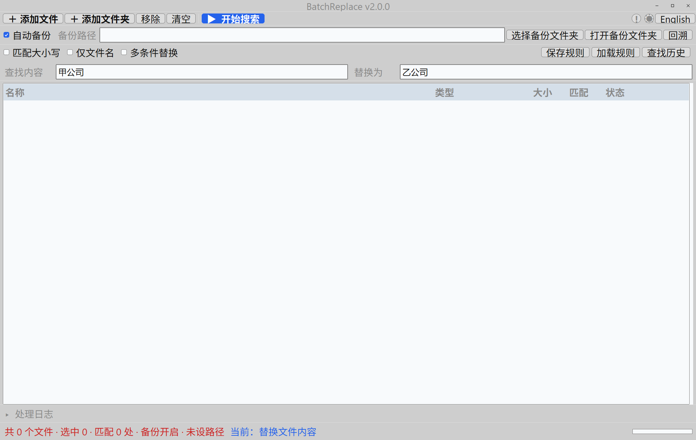
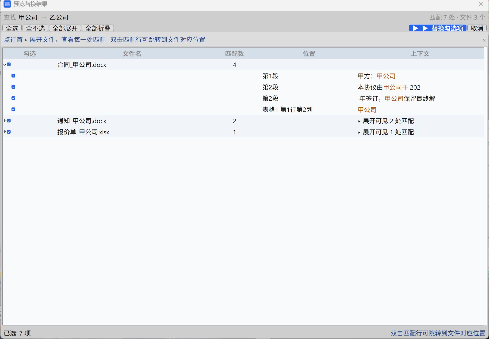
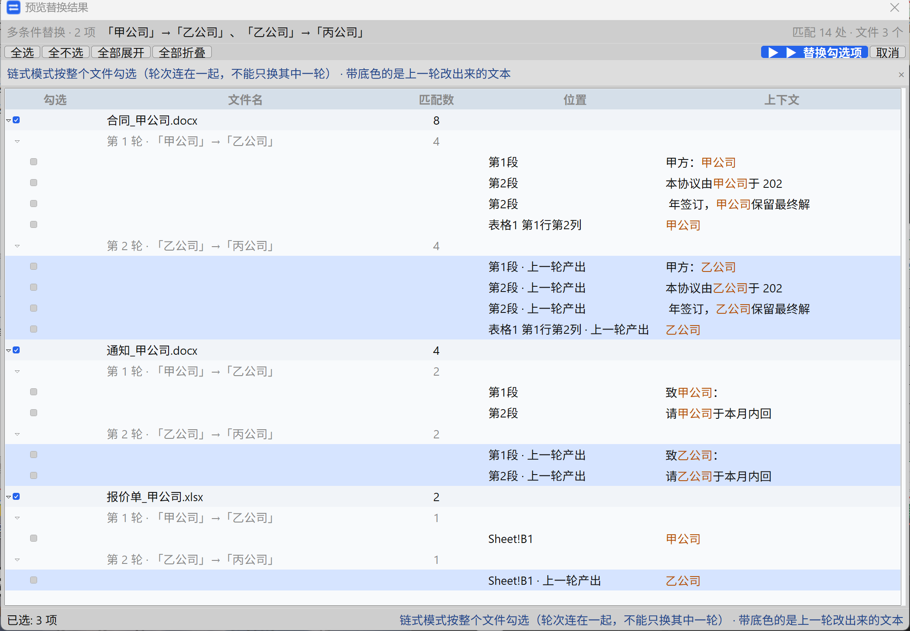
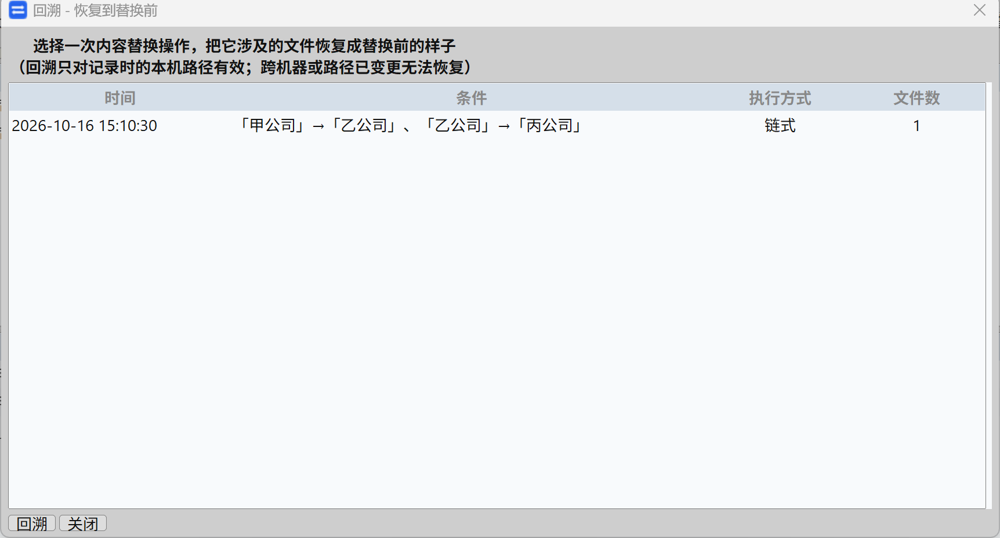

# BatchReplace

[](https://github.com/YehOlt/BatchReplace/releases)
[](https://github.com/YehOlt/BatchReplace/blob/main/LICENSE)


[English](README.en.md) ｜ **简体中文**

**批量替换工具**：在多个 Word / Excel / 纯文本文档里批量查找替换文本，保持原有格式与编码不变。

一次处理**多个文件**、可同时套用**多条替换条件**（例如 `甲公司→乙公司` 与 `2024→2025` 一起上），替换前逐处预览、按行勾选，替换前自动备份原文件。支持 `.docx` / `.xlsx` / `.txt`。

Windows 桌面工具（tkinter 图形界面），源码为单文件 `BatchReplace.py`，拷到任何地方都能直接运行，也可打包成不依赖 Python 的独立 exe。开源免费（MIT 许可）。

**当前版本：v2.0.0**

---

## 界面截图

**主界面**（初始状态）：



**点「开始搜索」后**：逐文件列出每一处匹配，可按行勾选、双击跳转：



**链式替换预览**：按轮次分组，上一轮产出被下一轮命中的行整行标色：



**回溯对话框**：列出全部内容替换记录，选中一条恢复它涉及的文件：



## 安装

请到发布页面下载对应的安装包：**[Release 页面](https://github.com/YehOlt/BatchReplace/releases)**，在最新版本下方展开 **Assets**，下载 `BatchReplace_v2.0.0.exe`，双击运行即可，无需安装 Python。

首次运行 Windows 可能提示「未知发布者」，选择「仍要运行」。

## 功能

### 批量替换能力

- **批量替换**：一次处理多个文件，支持 `.docx`（正文段落、表格、页眉页脚）、`.xlsx`（全部工作表单元格）与 `.txt`（全文，保持原编码）
- **保持格式**：只精确替换匹配的文字，不重建文档，字体、样式、合并单元格等原样保留；`.txt` 保持原编码（UTF-8 / GBK / BOM 均往返不变）
- **多条件替换**（可选）：一次搜索 / 一次替换里同时套用多条「查找 → 替换为」规则，例如 `甲公司→乙公司` 与 `2024→2025` 一起上。规则全部在**原文**上匹配、一次找出全部待改项，**不做链式叠加**（`a→b` 与 `b→c` 同时给出时，`ab` 得 `bc` 而不是 `cc`）
- **并行 / 链式两种执行方式**（多条件下拉选择，默认并行）：**并行**＝所有条件都在原文上找，互不干扰，一次替换完；**链式**＝按条件表从上到下依次执行，**上一条改完的结果，是下一条要找的文本**（适合 `甲公司→乙公司`、`乙公司→丙公司` 这类逐级改名）。条件表的顺序直接拖拽行即可调整（链式模式下从上到下即执行次序）。链式的预览按轮次分组，落在上一轮产出文本里的命中会整行标色并在位置列注明「上一轮产出」；勾选按整个文件生效（轮次连在一起，不能只换其中一轮），替换在临时副本上整条链跑完才写回，中途出错原文件一个字节都不会动。切换执行方式、或刚勾上「多条件替换」时，当前方式的说明（含一组小示例）会自动摆到下拉框下方，点 × 关闭
- **文件名替换**（可选）：把文件名本身也纳入替换范围；非法字符、Windows 保留设备名、改名冲突均在动手前预检并给出说明
- **大小写规则**：匹配时可选择区分 / 不区分大小写

### 匹配精度

- **Word**：正文段落、表格（含嵌套单元格）、页眉页脚、超链接内文字、修订插入（w:ins）内的文字都在覆盖范围内；自动跳过"链接到前一节"的页眉页脚以防匹配虚胖，自动跳过含图片 / 分页符 / 域代码的受保护区域，不制造虚假匹配
- **Excel**：公式单元格绝不改写；被替换的数字替换后仍是数字（bool / int / float / datetime / date / time 均还原为原单元格类型）
- **纯文本**：全文匹配，位置显示为「第 N 行, 第 M 列」；双击跳转改为打开文件并提示行列（记事本无法定位到具体字符）
- **多条件冲突规则**：① 查找内容不允许重复（替换为可以重复），重复会被拦下并指出是第几条与第几条；② 同一位置被多条规则同时匹配时**整批停下**——工具不做取舍，一个文件都不会改动，并在搜索后弹窗、日志与预览窗状态栏三处说明是哪几处冲突；③ 处理办法有两条：回条件表改掉重叠的那条，或在预览里取消勾选冲突的匹配行（冲突消失后「替换勾选项」自动恢复可用）

### 安全机制

- **自动备份**：替换前把原文件备份到独立文件夹，重名不覆盖；默认开启，备份策略可在界面切换
- **一键回溯**：每次内容替换成功后，当次备份夹里会写一份记录（用了哪些条件、并行还是链式、动了哪些文件）。点「回溯」选一条记录即可把涉及的文件恢复成替换前——二次确认默认停在取消上，支持只回滚部分文件；回滚前会先把当前文件快照进备份夹 `rollback_` 子夹，误回滚也能再捞回来；同一文件在更晚的操作里也改过时会先警告。文件名替换不写记录（回溯只覆盖内容替换），备份夹在 OneDrive 目录下时占位文件会在读写两端提示先下载
- **原子写入**：所有写回先写临时文件再整体替换，中途断电或异常也不会留下半截文件
- **失败即停，原文件零改动**：备份不可用、文件被占用、写入异常——任何一步出问题都当场中止并说明原因，不做"改一半"这种最难收拾的结果；预览里一条都没勾时也不会动任何文件
- **依赖缺失提示**：缺少 Python 库时明确告知缺什么，而不是静默地把文件判成「无匹配」

### 交互

- **替换前预览**：逐文件展开，列出每一处匹配；可按行勾选，只替换选中的部分
- **双击跳转**：在预览里双击某条匹配，用 Office / WPS 打开文件并定位到对应位置（需本机安装 Office / WPS）
- **查找历史与规则**：**按组展示**的查找历史（一组条件＝一条记录，展开看每条条件；单条件与多条件都记，还带上「区分大小写」和「作用对象」）。它只存条件本身，不记录动过哪些文件、结果如何，用途是下次直接复用——选中组头可整组载入、选中条件行可只载入那一条；替换规则可存成 JSON 复用
- **运行中锁定**：搜索 / 替换运行中，添加文件、添加文件夹、移除、清空等入口统一置灰，避免中途改动文件清单导致结果对不上
- **中英双语界面**：每次启动跟随系统语言，工具栏右侧按钮可随时切换（本次运行内有效，下次启动重新跟随系统）

## 适用场景

- **成批改名字**：一批合同 / 报告里的公司名、产品名、项目代号换了，逐个打开改太慢
- **换版本与抬头**：模板文件批量换年份、版本号、落款抬头
- **统一口径**：一批 Excel 表里把旧字段名 / 旧分类名一次改成新的
- **定稿前核对**：只搜索不替换，先看清某个词到底出现在哪些文件、哪些位置

## 支持的文件类型

| 类型 | 支持 | 说明 |
|---|---|---|
| `.docx` | ✅ | Word 2007+ 文档 |
| `.xlsx` | ✅ | Excel 2007+ 工作簿 |
| `.txt` | ✅ | 纯文本，保持原编码（UTF-8 / GBK / BOM 往返不变） |
| `.doc` / `.xls` | ❌ | 老版二进制格式，读取库不支持，程序会直接判为不支持而不是尝试后崩溃 |

## 使用 exe

按开头【下载】一节下载 `BatchReplace_v2.0.0.exe`，双击运行即可，无需安装 Python。

打包产物未做代码签名，首次运行 Windows 可能提示「未知发布者」，选择「仍要运行」即可。

## 从源码运行

```bash
pip install python-docx openpyxl pywin32
python BatchReplace.py
```

- `pywin32` 仅用于「双击跳转」定位功能；不装也能正常跑，只是跳转不可用。
- 运行源码需要自带 tkinter 的标准 CPython（本项目在 Python 3.12 上开发与打包）。
- 用到的 Python 库（版本为开发时锁定）：

| 库 | 版本 | 用途 |
|---|---|---|
| `python-docx` | 1.2.0 | 读写 `.docx` |
| `openpyxl` | 3.1.5 | 读写 `.xlsx` |
| `pywin32` | 306 | 调用 Office / WPS 打开文件并定位 |

## 打包成 exe

在项目根目录执行（PyInstaller 6.20.0）：

```bash
python -m PyInstaller --onefile --windowed --name BatchReplace ^
    --hidden-import win32com.client --hidden-import win32api ^
    --hidden-import pythoncom --hidden-import openpyxl ^
    --hidden-import docx --hidden-import numbers BatchReplace.py
```

几个要点：

- `--windowed`（等同于 `--noconsole`）保证双击运行时不弹黑框。
- 那串 `--hidden-import` 是必需的：`win32com` 系列与 `numbers` 属于动态导入，PyInstaller 的静态分析看不到，漏掉会在运行时才炸。
- 不建议启用 UPX 压缩：压缩系统 DLL 容易触发杀毒软件误报。
- 上面是能跑出可用 exe 的简化命令。Releases 里的正式版额外剔除了几个用不到的标准库模块以减小体积，功能与上面的命令打出来的完全一致。

## 测试

```bash
pip install pytest
pytest
```

单元测试共 **258 项**，直接导入 `BatchReplace.py` 本体（逻辑与界面同处一个文件），测的就是最终打包出去的同一份代码，覆盖历史上反复出问题的点：替换后数字类型不能变成字符串、备份不得覆盖同名文件、公式单元格不得被改写、大小写两种模式的匹配与替换、以及双语界面切换后控件文案与引擎层输出是否同步等。

## 常见叫法

这类工具没有统一的名字，你可能是按下面这些词找过来的：**批量替换工具**、批量查找替换、**Word 批量替换**、**Excel 批量替换**、多文件文本替换、批量改名工具。

本工具就叫 **BatchReplace**，没有别的官方别名。

## 作者

**YehOlt** · QQ: 16140220 · 邮箱: yelintaoooo@outlook.com

## 许可

[MIT License](https://github.com/YehOlt/BatchReplace/blob/main/LICENSE)
